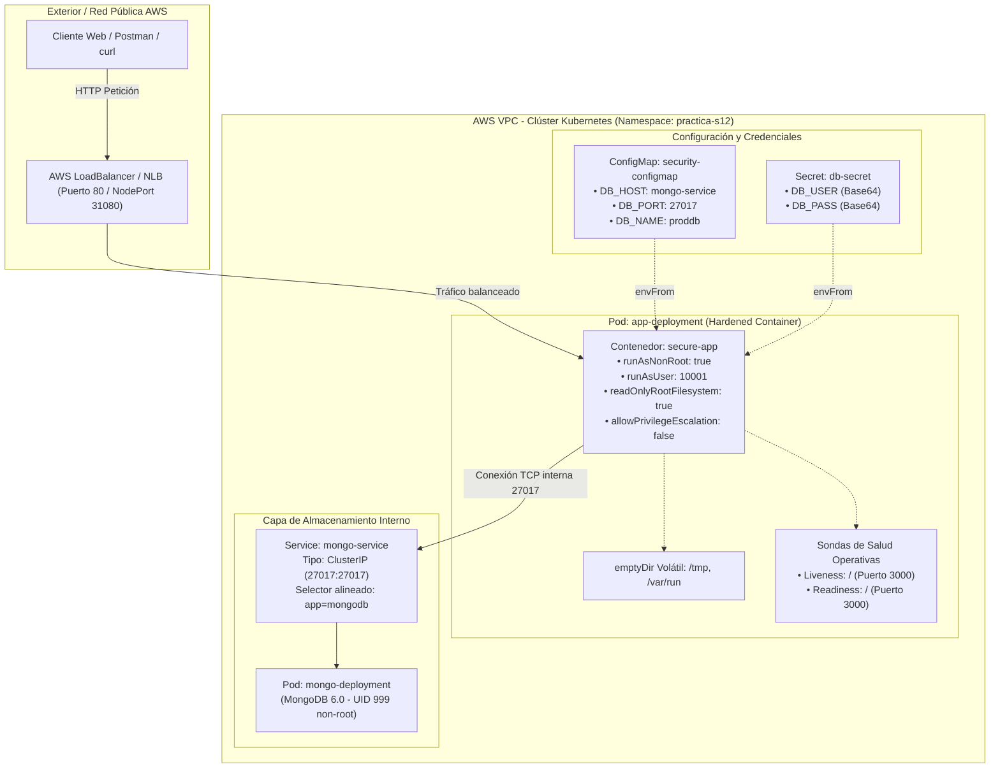

# Proyecto Práctico: Despliegue Cloud, Seguridad y Troubleshooting (S12 | AP9)

## 📌 Información General
- **Curso:** Orquestadores y Automatización de Software
- **Sesión:** S12 | AP9
- **Namespace:** `practica-s12`
- **Entorno:** Kubernetes sobre Amazon Web Services (AWS EKS / Cloud / Minikube)
- **Pilares:** Hardening de Seguridad (`SecurityContext`, Non-Root, UID 10001) + Diagnóstico y Resolución de Fallas (Troubleshooting de 3 Escenarios Críticos)

---

## 🏛️ Arquitectura y Escenario de Desafío



---

## 📁 Estructura del Repositorio

```text
/
├── k8s/
│   ├── 00-namespace.yaml             # Aislamiento del entorno en practica-s12
│   ├── 01-security-configmap.yaml     # Parámetros operativos (DB_HOST, DB_PORT, DB_NAME, APP_PORT)
│   ├── 02-db-secret.yaml              # Credenciales confidenciales codificadas en Base64
│   ├── 03-app-deployment.yaml         # Despliegue corregido con Hardening (UID 10001, Probes, ReadOnly)
│   ├── 04-app-service.yaml            # Exposición LoadBalancer (AWS ELB) / NodePort
│   └── with-errors/
│       └── 03-app-deployment-broken.yaml # Manifiesto con las 3 fallas para capturar el "Antes"
├── docs/
│   └── troubleshooting-log.md        # Bitácora técnica de fallas encontradas y soluciones
└── README.md                          # Documentación completa y guía de sustentación
```

---

## 🛡️ Hardening de Seguridad Implementado

Para garantizar un estándar de seguridad de nivel empresarial en entornos de nube:
1. **Prevención de Ejecución como Root:** `runAsNonRoot: true` a nivel de Pod y Contenedor.
2. **Asignación de UID Estricto:** `runAsUser: 10001` y `runAsGroup: 10001`.
3. **Restricción de Sistema de Archivos:** `readOnlyRootFilesystem: true`, impidiendo inyección de scripts o modificaciones maliciosas al binario en disco.
4. **Almacenamiento Temporal Volátil:** Montaje de volúmenes en memoria tipo `emptyDir` en rutas como `/tmp`, `/var/run` y `/var/cache/nginx`.
5. **Mitigación de Escalabilidad:** `allowPrivilegeEscalation: false` y remoción completa de capacidades de Linux (`drop: ["ALL"]`).

---

## ⚙️ Guía de Ejecución y Captura de Evidencias

### Paso 1: Crear el Namespace y la Configuración
```bash
kubectl apply -f k8s/00-namespace.yaml
kubectl apply -f k8s/01-security-configmap.yaml
kubectl apply -f k8s/02-db-secret.yaml
```

---

### Paso 2: Generar y Capturar el Escenario con Fallas (ANTES)
Aplica el manifiesto con las fallas inyectadas para obtener las evidencias iniciales:
```bash
kubectl apply -f k8s/with-errors/03-app-deployment-broken.yaml
```

#### 📷 Captura 1 (Parte A - Falla Inicial):
```bash
kubectl get pods -n practica-s12
```
*Visualizarás los Pods en estado `CrashLoopBackOff` o `CreateContainerConfigError`.*

#### 📷 Captura 3 (Diagnóstico de Logs y Eventos):
```bash
# Diagnóstico de eventos (muestra el fallo de la clave del Secret y sondas Unhealthy)
kubectl describe pod -l app=secure-app -n practica-s12

# Diagnóstico de logs (muestra la terminación del proceso)
kubectl logs -l app=secure-app -n practica-s12
```

---

### Paso 3: Aplicar la Solución Definitiva y Hardened (DESPUÉS)
Aplica los manifiestos corregidos con la arquitectura segura y las sondas operativas:
```bash
kubectl apply -f k8s/03-app-deployment.yaml
kubectl apply -f k8s/04-app-service.yaml
```

#### 📷 Captura 1 (Parte B - Estado Saludable):
```bash
kubectl get pods -n practica-s12
```
*Demuestra que todos los Pods (`app-deployment` y `mongo-deployment`) se encuentran en estado `Running` con `READY 1/1`.*

#### 📷 Captura 2 (Validación de Contexto de Seguridad):
```bash
# Obtener el nombre del pod de la aplicación
APP_POD=$(kubectl get pods -n practica-s12 -l app=secure-app -o jsonpath='{.items[0].metadata.name}')

# Demostrar que el proceso corre con UID 10001 y non-root
kubectl exec -it $APP_POD -n practica-s12 -- whoami || kubectl exec -it $APP_POD -n practica-s12 -- id
```
*La salida demostrará `uid=10001 gid=10001` sin privilegios administrativos.*

#### 📷 Captura 4 (Prueba de Servicio Funcionando en Red):
```bash
# Si estás en AWS EKS (obteniendo el DNS del LoadBalancer):
LB_HOST=$(kubectl get svc app-service -n practica-s12 -o jsonpath='{.status.loadBalancer.ingress[0].hostname}')
curl -i http://$LB_HOST/

# Si estás en Minikube / Nodo directo (vía NodePort 31080):
curl -i http://$(minikube ip):31080/
```
*Captura de la respuesta HTTP 200 OK confirmando la operatividad total de la aplicación.*

---

## 📹 Guía para el Video Demostrativo (3 a 5 minutos)

1. **0:00 - 0:45 | Presentación del Desafío:** Explicar el objetivo de seguridad en AWS y los 3 escenarios de falla.
2. **0:45 - 2:00 | Diagnóstico y Bitácora:** Mostrar la bitácora `troubleshooting-log.md` y explicar por qué fallaban las variables, el puerto de red del servicio de BD y la ruta de las sondas de salud.
3. **2:00 - 3:30 | Demostración en vivo:** Ejecutar `kubectl get pods -n practica-s12` (todos en Running), ejecutar `kubectl exec ... -- id` demostrando el UID 10001.
4. **3:30 - 4:45 | Prueba del Servicio:** Hacer la petición HTTP con curl o navegador hacia el LoadBalancer / NodePort.
5. **4:45 - 5:00 | Conclusiones:** Resaltar la importancia del principio de mínimo privilegio en Kubernetes.

